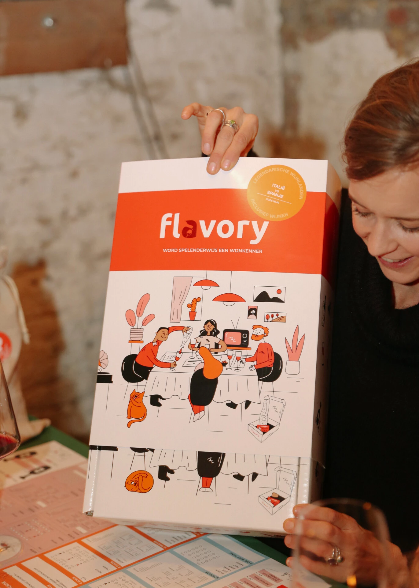
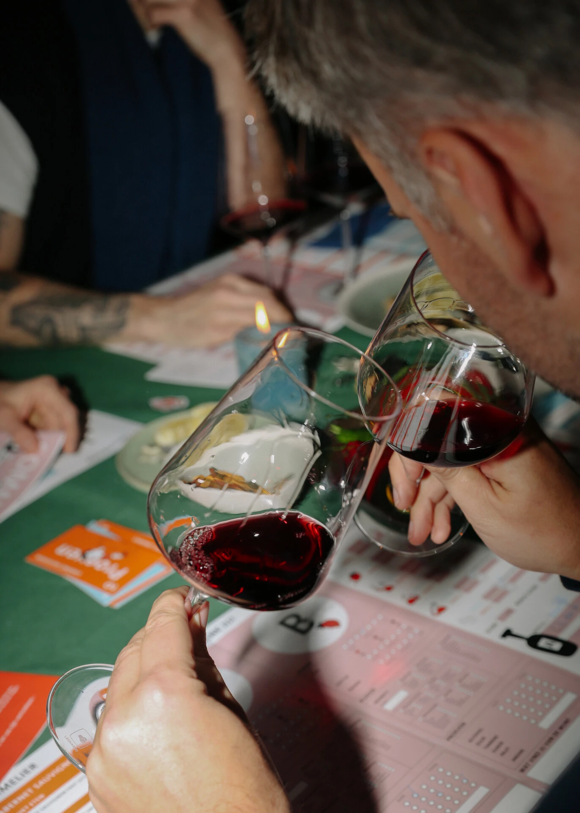
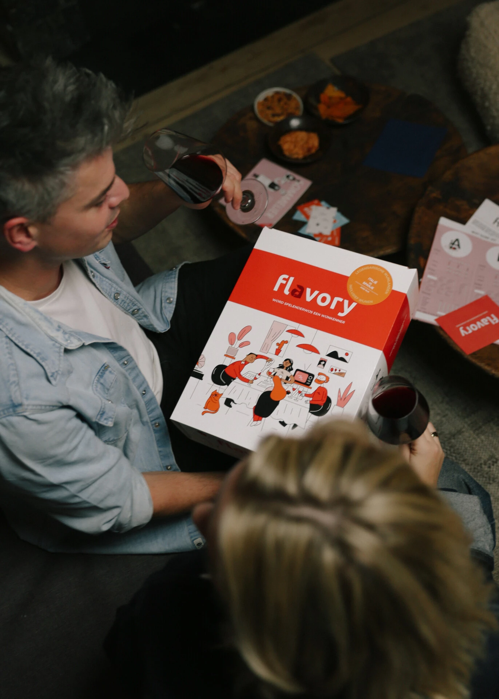
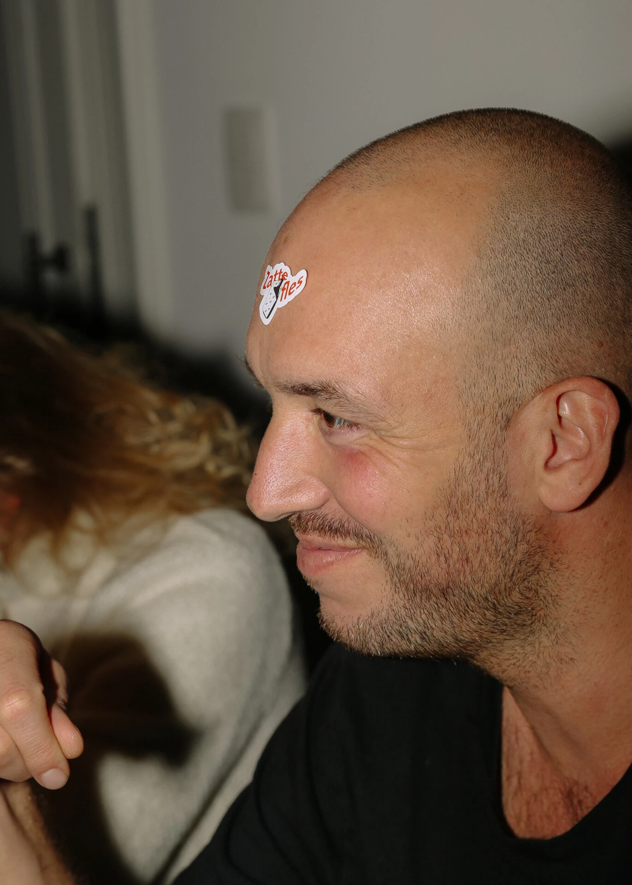

Ben je nog op zoek naar het **leukste kerstcadeau** van 2026? Waarom bestaan er eigenlijk zoveel verschillende wijnen, en waarom betaal je voor de ene fles 5 euro en voor de andere 25? Wijn is toch wijn? Wij vinden van niet. Met het [wijnspel van Flavory](/) proef je twee wijnen blind tegen elkaar: twee druiven die iedereen kent, anoniem verpakt in een stoffen zakje. Aan jou en je medespelers om ze te herkennen. De twee flessen wijn (75 cl) zitten in de doos.

## 5 redenen waarom het wijnspel onder de boom past

### 1. Leuk om te geven én om te krijgen

Niks tegen sokken, boeken of cadeaubonnen, maar die heb je vorig jaar ook al gegeven. Dit jaar ben jij de origineelste onder de kerstboom. Je geeft niet alleen wijn, maar ook het vooruitzicht van een gezellige avond. De doos ziet er bovendien prachtig uit. En nu maar hopen dat je zelf ook wordt uitgenodigd om mee te spelen.

### 2. Je leert echt iets over wijn

Wijnproeven, hoe doe je dat eigenlijk? Welke geuren ruik je? Welke wijn drink je zelf het liefst? Wat is het verschil tussen een glas [Merlot en een glas Cabernet Sauvignon](/blog/merlot-of-cabernet-sauvignon/)? Wedden dat je na het spel mango ruikt in je glas Chardonnay?

### 3. Een gezellige avond, gegarandeerd

Het wijnspel brengt familie en vrienden rond de tafel: 2 tot 6 spelers, een avond van 60 tot 90 minuten. Je hebt alleen nog wijnglazen nodig. De leukste gesprekken komen vanzelf op gang en iedereen doet mee. Dat je na één avond een volleerde wijnkenner bent, is overdreven. Dat je een avond beleeft die naar meer smaakt, is zeker. Niet tevreden? Je krijgt je geld terug.

### 4. Glasheldere spelregels

Geen ingewikkelde handleiding, beloofd. Je beantwoordt leuke quizvragen (hoeveel druiven zitten er in een glas wijn?) en verzamelt zo tips. De grote uitdaging is de wijnen herkennen: ruik jij chocolade? Het spel begint zodra de doos opengaat.

### 5. De winnaar is de wijnkenner van de avond

Spelen is leuk, winnen is nog leuker. Je hoeft geen kenner te zijn om tot wijnkenner van de avond uitgeroepen te worden. Een goede neus, frisse smaakpapillen en een beetje geluk brengen je al ver. En als je wint: waar hang je je diploma op?

## Rood of wit, Standaard of Premium

Kies de [rode box](/shop/wijnproeverij-thuis-rood/) met Merlot of Cabernet Sauvignon, of de [witte box](/shop/wijnproeverij-thuis-wit/) met Chardonnay of Sauvignon Blanc. In elke box zitten het wijnspel en twee flessen wijn (75 cl). De Premium-boxen, met twee duurdere wijnen die meer diepgang hebben, zijn binnenkort verkrijgbaar. Meer ideeën vind je bij onze [kerstcadeaus](/cadeau/kerstcadeau/).
